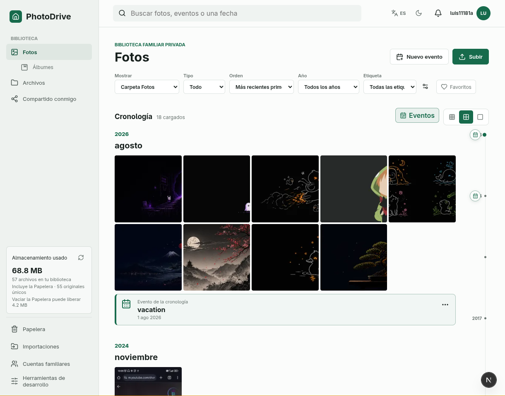

# PhotoDrive

PhotoDrive is a self-hosted family Photos + Drive application. It combines a
capture-date photo timeline, albums, real folders, private sharing, and
invite-only family accounts in one responsive web app, and runs on the
computers you already own.



This repository is the public, sanitized source. It contains no private
installation data: every host-specific value in the tracked configuration is a
placeholder you replace with your own.

## What it includes

- Photos timeline grouped by year and month, with a seekable scrubber, Timeline Events, and date, type, tag, and Favorite filters
- Albums with derived mosaic covers, viewer and collaborator sharing, and direct album uploads
- A Drive-style Files workspace with folders, sorting, previews, tags, recursive search, and folder/album ZIP downloads
- Resumable file and folder uploads, plus restart-safe Google Photos Takeout imports
- Capture-date corrections that never touch the original bytes
- Private sharing between owner-defined family accounts; password login and optional Google OAuth (OAuth never creates an uninvited user)
- Recoverable Trash with explicit, reviewed permanent cleanup
- Owner Developer tools: servers, backups, cache builds, storage audit
- English/Spanish and light/dark preferences

## Architecture

| Data | Where it lives |
| --- | --- |
| Catalog and accounts (names, folders, albums, sharing, users) | One shared [Turso Cloud](https://turso.tech) database; a family library fits in Turso's free plan |
| Original photo/video/file bytes | Your private S3 bucket, immutable and content-addressed by SHA-256 |
| Local read replica, original cache, thumbnails | Each PhotoDrive server's disk; always safe to delete and rebuild |
| Weekly verified database backup | A second private S3 bucket, as a plain SQLite file plus a manifest |

You can run PhotoDrive on several computers at once (for example a desktop and a
laptop). Every server keeps a **local read-only replica** of the Turso database:

- Page loads, the timeline, and search read from the local replica, so they answer in tens of milliseconds.
- Every save is one transaction directly against Turso Cloud, so it is either saved for every server or not at all. The server then reads back its own change immediately; other servers pull changes every 30 seconds.
- If Turso is unreachable, browsing keeps working from the replica and saves fail clearly (nothing is queued offline).
- One server is the **primary** for background work (metadata extraction, the weekly backup). Change it in **Developer tools → Servers**. If the primary stops for five minutes, another online server takes over automatically.

The backend is .NET 10 (ASP.NET Core, EF Core); the frontend is a Next.js static
export served by the backend from the same origin. The Docker image includes
ImageMagick, FFmpeg, and `file` for metadata and thumbnails.

## Requirements

- Docker with Compose v2 (Linux, or Docker Desktop with Linux containers on Windows)
- A free [Turso](https://turso.tech) account and the [Turso CLI](https://docs.turso.tech/cli/introduction)
- An AWS account (or S3-compatible storage) and the AWS CLI

## Setup

### 1. Create the Turso database

```bash
turso db create photodrive-production
turso db show photodrive-production --url
turso db tokens create photodrive-production
```

The database name must not contain `development`; Production refuses the Development database.

### 2. Create the S3 buckets

Use two different, private buckets. The originals bucket must **never** have an
expiration rule:

```bash
aws s3api create-bucket --bucket <your-originals-bucket> --profile photodrive
aws s3api put-public-access-block --bucket <your-originals-bucket> --profile photodrive \
  --public-access-block-configuration BlockPublicAcls=true,IgnorePublicAcls=true,BlockPublicPolicy=true,RestrictPublicBuckets=true
aws s3api put-bucket-versioning --bucket <your-originals-bucket> --profile photodrive \
  --versioning-configuration Status=Enabled
```

The backup bucket gets a retention rule (here 180 days). The backup upload refuses to run without it:

```bash
scripts/configure-s3-backup-buckets.sh <your-backups-bucket>:180
```

Store credentials for an IAM user limited to these two buckets in the `photodrive`
profile (`~/.aws/credentials` and `~/.aws/config`). The launcher mounts that
folder read-only into the container.

### 3. Fill in the configuration

The host settings live in `backend/main/DotnetBackEnd/solution/src/Hosts/CSSApps.Api/`.
Replace every placeholder (values containing `replace-`, `/absolute/path`, or
`example.com`). Production validation refuses to start while any remain.

| File | What to set |
| --- | --- |
| `infrastructure.json` | `Database:Url` (the `libsql://…` URL written as `turso://…`), both S3 bucket names and region. The Docker launcher overrides the local paths. |
| `authentication.json` | `JwtSettings:AccessTokenSecret` (for example `openssl rand -base64 48`), the bootstrap Owner email, and optionally a Google OAuth client ID |
| `deployment.json` | The hostnames and browser origins your family uses (LAN name, Tailscale name, or HTTPS domain) and the allowed client networks |
| `secrets.Production.json` | Copy `secrets.example.json`. Add the Turso token, an optional one-time Owner password, and the optional Google client secret. This file is ignored by Git. |

### 4. Start

Linux:

```bash
./photodrive setup
```

Windows (PowerShell):

```powershell
.\photodrive.ps1 setup
```

`setup` creates the data folders (default `~/Data` on Linux, `%USERPROFILE%\PhotoDriveData`
on Windows), builds the image, validates the configuration, applies the database
migrations, and starts the server. Open the configured origin (port 60020 by
default) and sign in as the Owner.

Everyday commands: `start`, `stop`, `restart`, `update` (build, migrate, restart),
`status`, `logs`, `health`, `validate`. Use `configure` to save a different data
folder, port, or bind address (`--data-directory`, `--port`, `--bind-address`, …).

### Adding another server

On a second computer, clone the repository, use the same configuration files and
`secrets.Production.json`, and run `./photodrive update` (or `start`). It
downloads its own local replica and joins the same library. Do not run
migrations from two computers at the same time.

## Backups and recovery

- Turso Cloud keeps its own history of the database.
- The primary server also exports a verified, standard SQLite copy to the backup bucket every 7 days (`MediaStorage:Backups:IntervalDays`), checking integrity and references before and after upload. Owners can run **Backup now** in Developer tools at any time.
- To restore, import a backup set into a new Turso database with `turso db import` and point `Database:Url` at it. Never copy a live replica file.
- Original bytes are never deleted on a timer: Trash is recoverable until an owner clears it, and storage cleanup needs a review, typed confirmation, and a fresh verified backup.

## Development

Prerequisites: .NET 10 (pinned by `global.json`), Node.js 22+, ImageMagick, FFmpeg, and `file`.

1. Create a separate Development Turso database (its name should contain `development`) and fill in `infrastructure.Development.json`, `authentication.Development.json`, and `secrets.Development.json`.
2. Apply migrations: `./photodrive migrate --environment development`.
3. Run the backend:

   ```bash
   cd backend/main/DotnetBackEnd/solution
   dotnet run --project src/Hosts/CSSApps.Api
   ```

4. Run the frontend (copy `frontend/.env.example` to `frontend/.env.local` first):

   ```bash
   cd frontend
   npm ci
   npm run dev
   ```

Development seeds the owner from `usersSettings.Development.json`; replace its placeholder password.

Tests:

```bash
cd backend/main/DotnetBackEnd/solution
dotnet test tests/MediaExplorer.Media.Tests/MediaExplorer.Media.Tests.csproj
```

```bash
cd frontend
npm run lint
npm run build
```

## Security notes

- Keep the app on your LAN or tailnet, or put it behind HTTPS. Never router-forward the plain HTTP port.
- The browser never receives S3 keys, database tokens, content hashes, or storage paths. Sessions use HttpOnly cookies with CSRF protection.
- Never commit `secrets.*.json`, `.env` files, or real values in the tracked JSON files.

## License

PhotoDrive is licensed under the GNU Affero General Public License v3.0. See [LICENSE](LICENSE).
The vendored `Turso.EntityFrameworkCore.Sqlite` provider keeps its own license in its folder.
