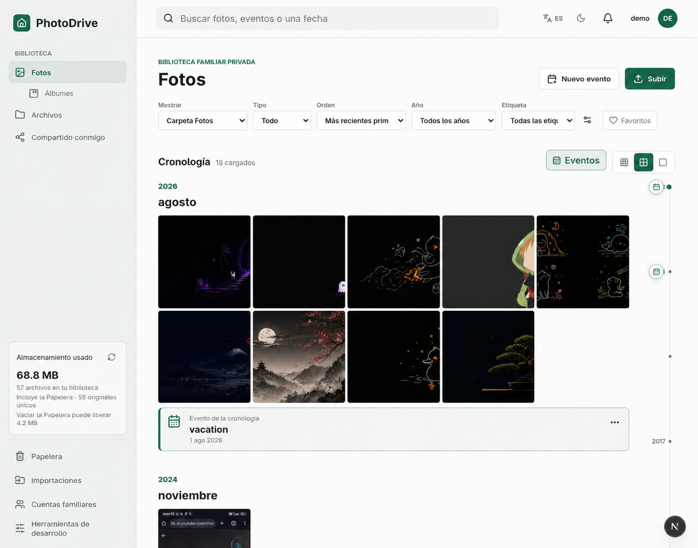

# PhotoDrive

PhotoDrive is a self-hosted family Photos + Drive application. It combines a
capture-date photo timeline, albums, real folders, private sharing, and
invite-only family accounts in one responsive web app.



This repository is the sanitized, self-hostable distribution. It contains no
private installation configuration, credentials, media, databases, or machine
paths. The public showcase in `demo-frontend/` is backend-free and uses a
sanitized product image.

## What it includes

- Photos timeline grouped by year and month, with date, type, tag, and Favorite filters
- Timeline events, albums, capture-date corrections, search, and image/video viewing
- A Drive-style Files workspace with folders, sorting, previews, and recursive search
- Resumable file and folder uploads plus restart-safe Google Photos Takeout imports
- Private folder and album sharing between owner-defined family accounts
- Password login and optional Google OAuth; OAuth never creates an uninvited user
- Recoverable Trash with explicit, guarded permanent cleanup
- Private S3 originals, verified SQLite backups, and rebuildable local caches
- English/Spanish and light/dark preferences

## Quick start

You need Docker with Compose v2 and an AWS account or compatible credentials
that may create/configure two private S3 buckets. The bucket names must be
globally unique and different from each other.

```bash
install -m 600 .env.example .env
```

Edit the REQUIRED section in `.env`, then run:

```bash
./photodrive setup
```

That single command creates and hardens the S3 buckets, builds one image with
the frontend and backend, applies the checked-in SQLite migrations explicitly,
and starts the application with a persistent Docker volume.

Open the exact address configured in `PHOTODRIVE_ORIGIN` and sign in with the
bootstrap owner credentials. Change the temporary password immediately. After
the first Owner is active, you may remove `PHOTODRIVE_OWNER_PASSWORD` from
`.env` and recreate the container with `./photodrive start`.

Useful commands:

```bash
./photodrive status
./photodrive logs
./photodrive validate
./photodrive update
./photodrive stop
```

`stop` does not delete the named `photodrive-data` volume. Do not run
`docker compose down --volumes` unless you deliberately intend to remove the
local databases, keys, caches, and local backup staging area.

## One configuration file

`.env` is the only user-edited runtime file. It is ignored by Git. Required
values appear first; optional settings and documented defaults appear below
them. See [Configuration](docs/CONFIGURATION.md) for Google OAuth, reverse
proxy, network allowlist, cache, and backup details.

Never commit `.env`. Docker environment variables are visible to administrators
of the Docker host, so the host itself remains part of the trust boundary.

## Storage and recovery

PhotoDrive deliberately gives each layer one job:

| Layer | Role |
| --- | --- |
| Private originals bucket | Immutable, content-addressed original bytes |
| SQLite catalog + users database | Folders, albums, shares, accounts, and mutable metadata |
| Local Docker volume | Databases, keys, staging, thumbnails, cache, and local backup snapshots |
| Private backup bucket | Remotely verified catalog-and-user backup sets |

The originals and backup buckets must be versioned and private. `setup`
configures public-access blocking, bucket-owner enforcement, AES-256 server-side
encryption, and versioning. It also gives the backup bucket the retention policy
expected by the application.

Backups run every 12 hours by default. A checkpoint advances only after a
timestamp-matched catalog/users set has been restored, integrity-checked,
uploaded, and remotely checksum-verified. S3 protects original bytes; SQLite
backups protect the library organization people recognize. You need both.

Read [Backup and restore](docs/BACKUP_AND_RESTORE.md) before your first upgrade
or recovery drill.

## Safe exposure

`http://localhost:8080` is the simplest first setup. For access outside the
host, prefer a private VPN or an HTTPS reverse proxy. Set the exact public HTTPS
origin in `PHOTODRIVE_ORIGIN`; if a proxy directly fronts the container, also
set `PHOTODRIVE_BEHIND_PROXY=true` and narrowly identify its trusted network.

PhotoDrive uses HttpOnly cookies, CSRF protection, authorization, rate limits,
security headers, private S3 access, and optional client-network allowlisting.
The browser never receives S3 credentials, bucket names, object keys, or hashes.

## Development

Frontend:

```bash
cd frontend
npm ci
npm run lint
npm run build
```

Backend:

```bash
cd backend/main/DotnetBackEnd/solution
dotnet test tests/MediaExplorer.Media.Tests/MediaExplorer.Media.Tests.csproj
dotnet build src/Hosts/CSSApps.Api/CSSApps.Api.csproj --no-restore
```

The browser contract is documented in [backend/API.md](backend/API.md). The
public landing page can be built independently from `demo-frontend/`.

## Scope

PhotoDrive is family-focused software, not a general collaboration suite. It
does not provide public share links, editor roles, office document conversion,
face recognition, OCR search, or reliable browser-only automatic phone backup.

## License

PhotoDrive is licensed under [GNU AGPL-3.0-only](LICENSE). If you modify it and
let users interact with the modified application over a network, the license
requires offering those users the corresponding source.
